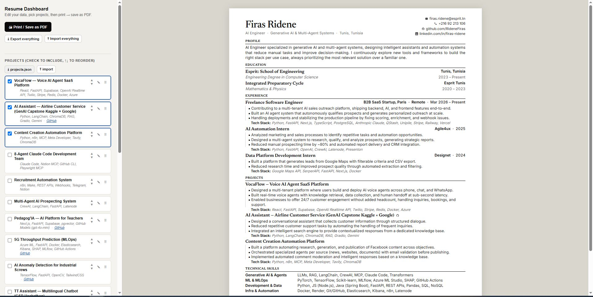
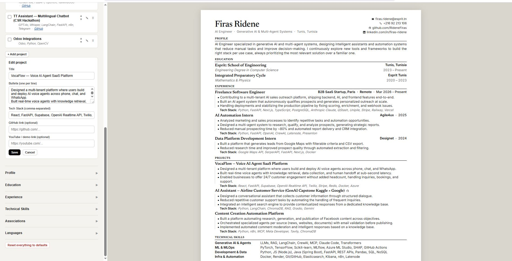

# Resume Dashboard

A small internal tool I built for myself while applying to jobs.

  
  

## Why

I was changing my resume a lot, swapping projects in and out depending on which role I was applying for, and it got tedious fast. Every time I wanted a different mix of projects on the resume, I'd end up manually editing HTML, breaking the layout, or losing track of which version I sent to which company.

So I built this. It's a single HTML file that runs entirely in the browser: a small dashboard on one side where I manage my projects (and the rest of the resume) as data, and a live preview on the other side that always reflects exactly what will get printed. No backend, no build step, no dependencies.

## What it does

- Keeps every section of the resume (Profile, Education, Experience, Projects, Technical Skills, Associations, Languages) as editable data instead of hardcoded HTML.
- Lets me check/uncheck which projects show up on a given version of the resume, and reorder them.
- Everything else (Profile, Education, Experience, Skills, Associations, Languages) lives in its own collapsed section since I don't touch those often, but they're just as editable when I need to.
- Optional GitHub / demo video links per project, shown as small clickable icons next to the title.
- Autosaves to the browser's local storage as I go, so I can close the tab and come back later.
- Each section can be exported/imported as its own JSON file, plus one combined export for a full backup.
- When I'm happy with the version, I hit print and save as PDF straight from the browser's native print dialog. The dashboard controls are hidden automatically in print view, so only the resume itself gets printed.

## How to use it

1. Open `resume_dashboard1.html` in any browser. That's it, no server needed.
2. Edit your data on the left panel.
3. Watch the resume update live on the right.
4. Hit **Print / Save as PDF** when it looks right.

## Files

- `resume_dashboard1.html` — the whole tool (dashboard + live resume + print logic) in one file.
- `profile.json`, `education.json`, `experience.json`, `projects.json`, `certifications.json`, `skills.json`, `associations.json`, `languages.json` — the default data for each section, and also what you get when you use the per-section export button. Handy as a backup or if you'd rather edit the data by hand.

## Notes

- Data is stored in `localStorage`, scoped to your browser. It doesn't sync across devices or browsers on its own, that's what the export/import buttons are for.
- The layout is tuned to stay clean when printed to PDF (single column, no fancy grid/flexbox tricks that can mess with how parsers read the text).
- This was built for my own use, so the seeded data is my own resume content. If you fork it, swap out the `DEFAULT_*` objects near the top of the `<script>` tag with your own.

## Stack

Just HTML, CSS, and vanilla JS. No frameworks, no build tools, nothing to install.